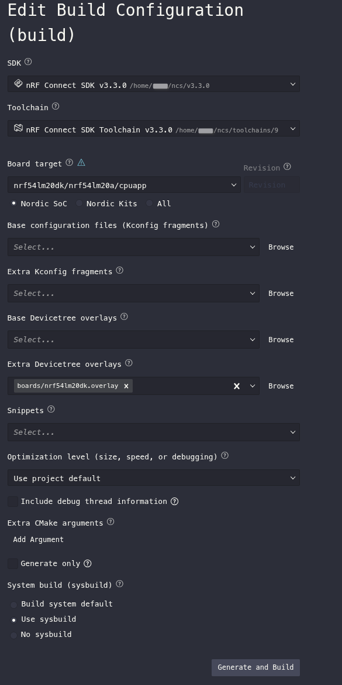

# B0 + MCUboot Secure Boot Example (nRF54LM20A)

This is a working example of a three stage secure boot chain on the nRF54LM20A: B0 (NSIB) verifying and booting MCUboot from one of two slots (S0/S1), and MCUboot verifying and booting the application. The application is blinking LED example with added support for BLE. BLE support was copied from `zephyr/samples/subsys/mgmt/mcumgr/smp_svr/src/bluetooth.c`.

## What's actually in this project

- `src/main.c` and `src/bluetooth.c`: blinks an LED and starts BLE advertising for SMP (mcumgr over BLE).
- `prj.conf`: application level config, mostly mcumgr setup for both UART and BLE transports.
- `sysbuild.conf`, `sysbuild/b0.conf`, `sysbuild/mcuboot.conf`: pulls in B0 and MCUboot as sysbuild child images, sets the signing keys, and turns on automatic KMU key provisioning.
- `pm_static.yml`: the static partition layout.
- `boards/nrf54lm20dk.overlay` and `sysbuild/mcuboot.overlay`: devicetree overlays, the app logs over `uart20` and MCUboot logs separately over `uart30`.
- `keys/`: two ed25519 key pairs used for signing. `ed25519_2_private.pem` is the one actually referenced in `sysbuild.conf` for both B0 and MCUboot.

## Opening and building the project

This was built using nRF Connect for VS Code. Open the project, go to the build configuration screen, and set it up like this:

The settings that matter:

- **SDK**: nRF Connect SDK v3.3.0 (Must be at least v3.0.0)
- **Toolchain**: matching SDK version toolchain
- **Board target**: `nrf54lm20dk/nrf54lm20a/cpuapp`
- **Extra Devicetree overlay**: `boards/nrf54lm20dk.overlay` (If you don't need logging, you don't have to add this)
- **System build (sysbuild)**: Use sysbuild

Make sure to enable sysbuild so that the project build's as expected.  

## Flashing

Use **Erase and Flash to Board**, not a regular flash.

This isn't optional. B0's verification depends on a public key hash sitting in the KMU before it ever runs, and that provisioning has to happen on the first flash. `sysbuild.conf` has `SB_CONFIG_SECURE_BOOT_GENERATE_DEFAULT_KMU_KEYFILE=y` set, which generates and pushes that keyfile into the KMU automatically, but only on a flash that actually goes through the recovery/erase path. A plain flash without erasing won't reliably provision the keys, and B0 will just refuse to boot into MCUboot if the keys aren't there.

If you change the signing key later and reflash without erasing, expect the same failure. The old key doesn't get replaced automatically, the new one has to be provisioned again.

## Updating MCUboot and the application

Once the chain is flashed and running, mcumgr is available over both UART and BLE for updating things:

- Updating MCUboot itself means uploading a new S0 or S1 image (whichever slot isn't currently active), this is the part B0 actually changes compared to a plain MCUboot setup.
- Updating the application goes through the normal MCUboot primary/secondary swap, unaffected by B0 being in the chain.

The exact commands for both UART and BLE, plus the build artifact names to look for, are in the two companion articles.

## Known limitation

There's currently no automatic way for the device or the update tooling to know which of S0/S1 is active, so picking the right upload target is a manual decision for now. Covered in more detail in `b0-mcuboot-integration-nrf54lm20a.md` under "Open item".